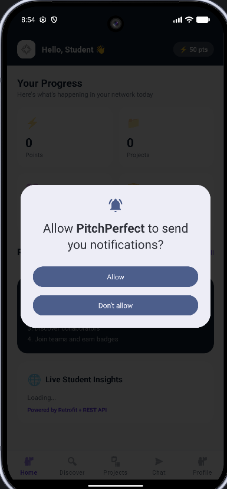
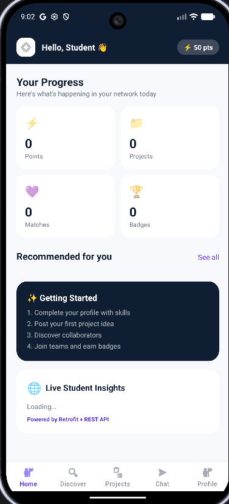
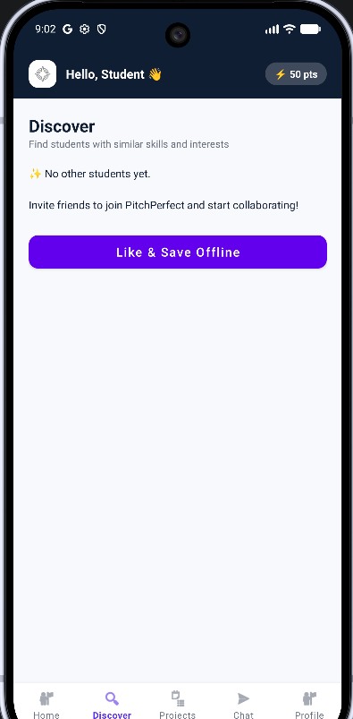
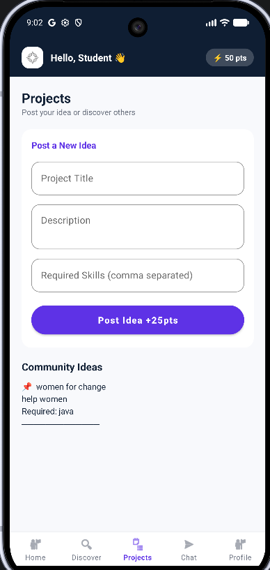
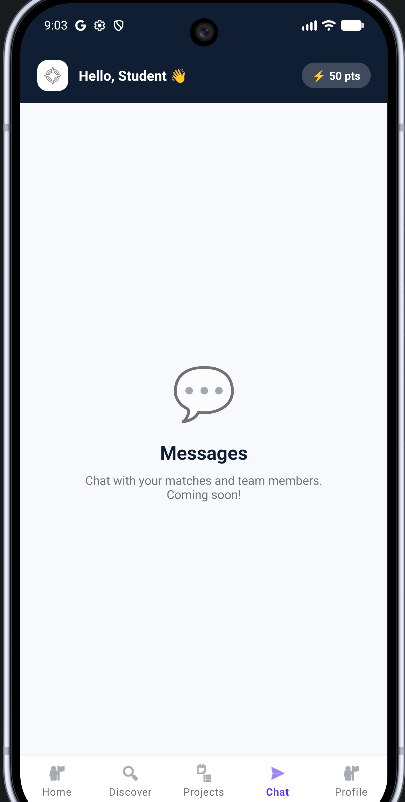
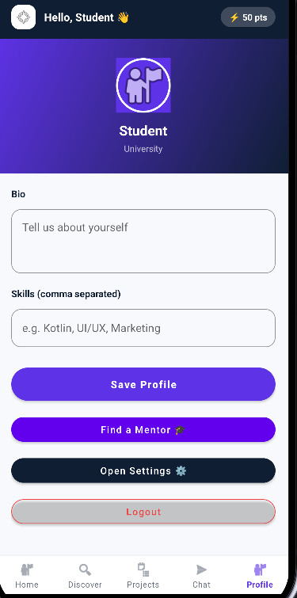
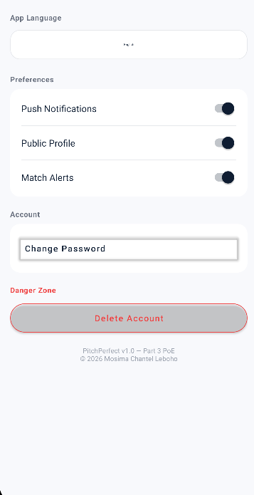
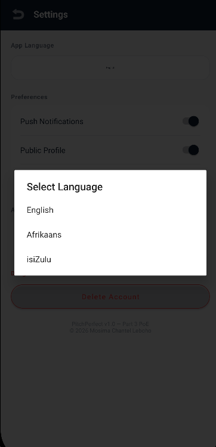
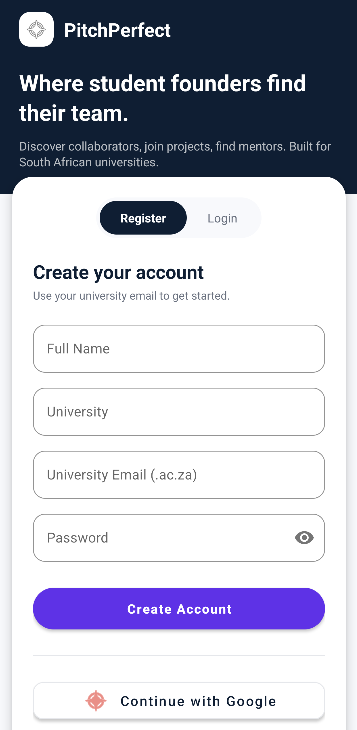

# 📱 PitchPerfect: Student Entrepreneurship Platform

> **Module:** Open Source  
> **Institution:** The Independent Institute of Education (IIE)  
> **Project:** Final Portfolio of Evidence (PoE) - Part 3

## 👥 Authors & Contributors
*   **Mosima Chantel Leboho** (ST10456440)

---

## 🎯 About the Project
**PitchPerfect** is an open-source, mobile-first networking and collaboration platform designed specifically for university students developing early-stage business ideas. 

It bridges the gap between fragmented networking tools by providing a unified space where student entrepreneurs can find collaborators, connect with mentors, and manage their startup projects.

---

## 📸 App Screenshots

| Home & Notifications | Dashboard | Discover |
| :---: | :---: | :---: |
|  |  |  |

| Projects | Chat | Profile |
| :---: | :---: | :---: |
|  |  |  |

| Settings | Language Selection | Register / Login |
| :---: | :---: | :---: |
|  |  |  |

---

## ✨ Core Features
*   🔐 **Secure Authentication:** Register and login with SHA-256 encrypted passwords.
*   🔑 **Single Sign-On (SSO):** Seamless login via Google Authentication.
*   🧠 **Skill-Based Matching Algorithm:** A custom Kotlin algorithm calculates a match percentage between a student's skills and a project's required skills.
*   💡 **Business Idea Publishing:** Create, view, and publish startup ideas.
*   ☁️ **Blob Storage:** Upload custom cover images for ideas using Firebase Storage.
*   🎓 **Mentorship Directory:** Browse industry experts and send mentorship requests.
*   📶 **Offline Mode with Sync:** "Like" ideas while offline; the app saves to a local Room Database and automatically syncs to Firestore when the connection returns using WorkManager.
*   🔔 **Real-time Notifications:** Receive instant push notifications for matches and updates via Firebase Cloud Messaging (FCM).
*   🌍 **Multi-Language Support:** Fully localized in English, isiZulu, and Afrikaans.

---

## 🎨 Design & Architecture
*   **UI/UX:** Designed using Figma and built with **Material Design 3**. The color palette (Navy, Purple, White) promotes academic excellence and innovation.
*   **Architecture:** Built using **Kotlin**, following the **MVVM** (Model-View-ViewModel) pattern for clean separation of concerns.
*   **Backend:** Firebase (Authentication, Firestore NoSQL, Storage, FCM).
*   **Local Storage:** Room Database for offline capabilities.

---

## 🚀 Release Notes (v1.0 Final PoE)
This version includes significant upgrades since the Part 2 Prototype.

*   **Added:** Multi-Language Support (isiZulu & Afrikaans).
*   **Added:** Blob Storage implementation for Idea cover images.
*   **Added:** Firebase Cloud Messaging (Push Notifications).
*   **Added:** Offline Sync using Room DB & WorkManager.
*   **Added:** Google SSO (Single Sign-On).
*   **Added:** Mentorship Directory module.
*   **Improved:** Match Algorithm now dynamically calculates compatibility instead of using placeholder data.

---

## 🎥 Video Demonstration
Watch the full demonstration of the PitchPerfect app running on a physical Android device:

👉 **[Click here to watch the YouTube Short](https://youtube.com/shorts/KIRjUzFPybc?feature=share)**

---

## 🛠️ CI/CD Pipeline (GitHub Actions)
This project utilizes GitHub Actions for Continuous Integration. On every push to the `main` or `master` branch, the workflow automatically:
1.  Provisions an Ubuntu environment with Java 17.
2.  Caches Gradle dependencies for faster builds.
3.  Executes `./gradlew build` to compile the Kotlin code and run unit tests, ensuring no breaking changes are introduced.

---

## 🤖 AI Usage Declaration 
In accordance with the open-source module guidelines, the following AI tools were utilized during development:

*   **Debugging Gradle Errors:** AI was used to resolve deprecated `kapt` issues by migrating the Room database to the modern **KSP** (Kotlin Symbol Processing) plugin for Gradle 9+ compatibility.
*   **SSO Configuration:** AI assisted in troubleshooting a `DEVELOPER_ERROR (10)` during the Google SSO setup by identifying a SHA-1 fingerprint mismatch, and migrating to the Legacy Google Sign-In API to bypass a known Android 16 compatibility bug on physical devices.
*   **UI Styling:** AI assisted with generating Material Design 3 XML layouts (custom RecyclerView adapters and CardViews) to ensure a pixel-perfect UI.
*   **Boilerplate Generation:** AI helped generate standard boilerplate code for Firebase Firestore queries, Room entities, and WorkManager implementations.

---
*© 2026 Mosima Chantel Leboho. Built for South African Universities.*
